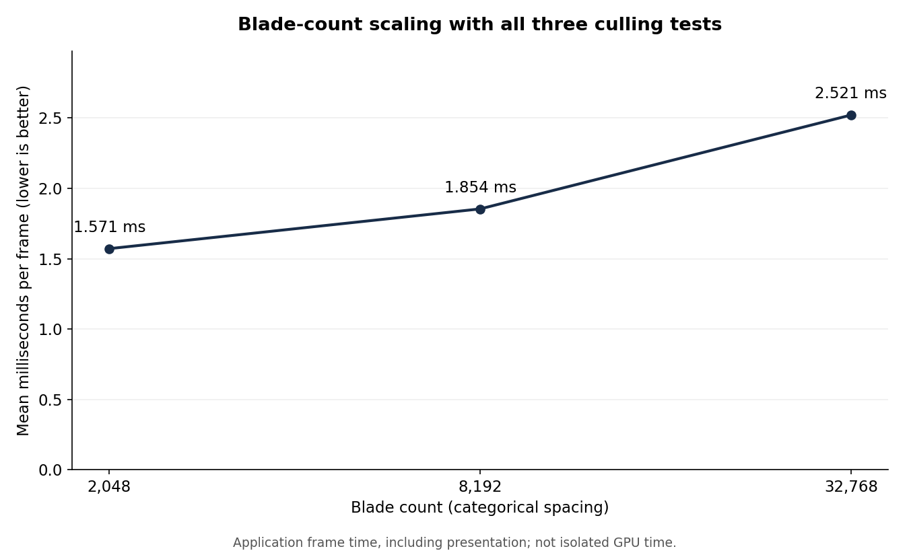
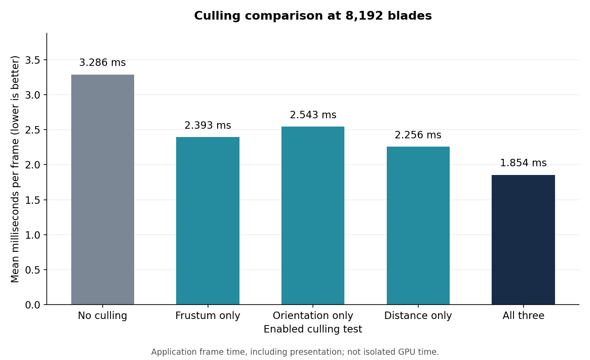

Vulkan Grass Rendering
==================================

**University of Pennsylvania, CIS 565: GPU Programming and Architecture, Project 5**

* Author: Thomas Lee
* Tested on: Windows 11 Pro, AMD Ryzen 9 7845HX, 64 GB RAM, NVIDIA GeForce RTX 4070 Laptop GPU (8 GB). Personal laptop.

## Overview

For this project, I used a compute shader to simulate the grass and tessellation to create the visible blades. Each blade is represented by a quadratic Bezier curve with three control points. I also store its orientation, height, width, and stiffness. Gravity, recovery, and wind move the tip, then I update the other control point to maintain the curve. I also keep the tip above the ground and correct the curve so its length stays approximately the same.

After updating the blades, I check which ones should be drawn and write them into a separate buffer. An atomic counter tracks how many blades remain, and the indirect draw uses that count. Tessellation gives each blade its curved, tapered shape, with one subdivision across the width and eight along the height. Finally, the fragment shader adds green diffuse shading. Distant grass becomes less dense through distance culling, but each remaining blade still uses the same tessellation detail.

## Performance analysis

I measured FPS and frame time using the console output, which averages the frames over roughly one second at a time. The results below are the averages of those samples. These timings include the application loop and presentation, so they do not measure just the GPU shaders.

### Scaling with blade count

| Blades | Samples | Mean FPS | Mean ms/frame |
|---:|---:|---:|---:|
| 2,048 | 17 | 638.8 | 1.571 |
| 8,192 | 21 | 542.5 | 1.854 |
| 32,768 | 19 | 399.1 | 2.521 |

For these tests, I kept all three culling tests enabled. As expected, we can see that frame time increases as the blade count increases. Going from 2,048 to 32,768 blades increased the count by 16 times, while the average frame time went from 1.571 ms to 2.521 ms, an increase of about 60.5%.

Based on my results I expect the increase to be linear, but I could not collect more measurements because my computer kept crashing.

### Culling comparisons

For the culling comparisons, I used 8,192 blades and kept the camera unchanged. Each test improved the average frame time compared to no culling. Distance culling gave the largest improvement on its own, reducing frame time from 3.286 ms to 2.256 ms. Frustum culling came next at 2.393 ms, followed by orientation culling at 2.543 ms.

Using all three gave the lowest average frame time at 1.854 ms. This is about a 1.77× speedup, or a 43.6% reduction in frame time compared to no culling. The all-three result uses the same 8,192-blade samples from the scaling test above.

## References

- [Khronos compute shader tutorial](https://docs.vulkan.org/tutorial/latest/11_Compute_Shader.html)
- [Khronos synchronization examples](https://docs.vulkan.org/guide/latest/synchronization_examples.html)
- Course Project 5 recitation slides for simulation, Bézier construction, and culling.
